# TyreMate ERP — Operations & User Manual
**Version 2.0 | Commercial Workshop & Tyre Dealership Edition**

---

## Executive Summary & System Overview

**TyreMate ERP** is a specialized, industrial-grade Enterprise Resource Planning system tailored specifically for tyre dealerships, automotive service centres, and retreading facilities. It streamlines the end-to-end operational lifecycle: from initial customer inquiries and point-of-sale customer intake to inventory bin management, retreading contract management (DAG), supplier procurement, and financial reporting.

### Core System Architecture

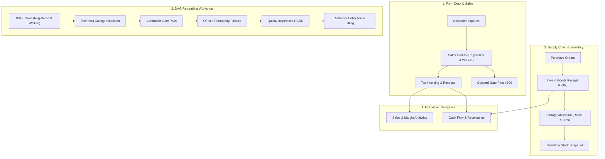

---

## Table of Contents

1. [Chapter 1: Getting Started & Authentication](#chapter-1-getting-started--authentication)
2. [Chapter 2: Navigation & Executive Dashboard](#chapter-2-navigation--executive-dashboard)
3. [Chapter 3: Customer Inquiry Management](#chapter-3-customer-inquiry-management)
4. [Chapter 4: Sales Orders & Customer Dispatch](#chapter-4-sales-orders--customer-dispatch)
5. [Chapter 5: Direct Action Goods (DAG) / Tyre Retreading](#chapter-5-direct-action-goods-dag--tyre-retreading)
6. [Chapter 6: Procurement & Purchase Orders (PO)](#chapter-6-procurement--purchase-orders-po)
7. [Chapter 7: Goods Receipt Notes (GRN) & Quality Control](#chapter-7-goods-receipt-notes-grn--quality-control)
8. [Chapter 8: Inventory & Multi-Location Storage Management](#chapter-8-inventory--multi-location-storage-management)
9. [Chapter 9: Master Data Administration](#chapter-9-master-data-administration)
10. [Chapter 10: Invoices, Billing & Payment Receipts](#chapter-10-invoices-billing--payment-receipts)
11. [Chapter 11: Reports & Financial Analytics](#chapter-11-reports--financial-analytics)
12. [Chapter 12: Troubleshooting, Security & Industrial Practices](#chapter-12-troubleshooting-security--industrial-practices)

---

## Chapter 1: Getting Started & Authentication

### 1.1 Launching the Application
Launch TyreMate from your desktop or application launcher. The system initializes an offline-first high-performance SQLite engine, verifying database schema integrity, encryption flags, and local hardware printer drivers before rendering the login portal.

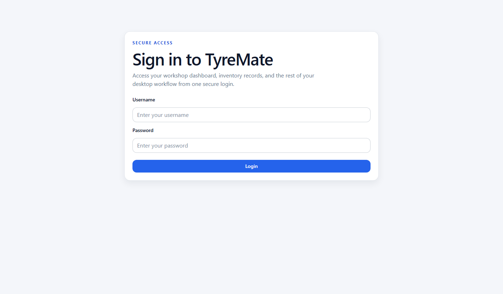

### 1.2 User Authentication
1. Enter your assigned **Username** and **Password**.
2. Click **Login** or press <kbd>Enter</kbd>.
3. If temporary administrator credentials are used, the system prompts for an immediate credential rotation.

### 1.3 Role-Based Access Control (RBAC)
TyreMate enforces rigorous role-based permission tiers:

| Role | Permissions & Operational Scope |
| :--- | :--- |
| **System Administrator** | Unrestricted access across all branches, database maintenance, master configurations, user management, and financial overrides. |
| **Branch Manager** | Order authorization, credit term adjustments, contractor assignment, stock write-offs, and report export. |
| **Cashier / Front-Desk** | Inquiry logging, registered & walk-in sales order intake, payment receipting, DAG intake, and invoicing. |
| **Storekeeper / Workshop Officer**| Goods receipt inspection, storage rack allocation, gate pass issuance, and casing inspections. |

> [!IMPORTANT]
> Always lock your terminal or log out when leaving your workstation. All transactions and gate pass dispatches are permanently stamped with your operator user ID.

---

## Chapter 2: Navigation & Executive Dashboard

### 2.1 Dashboard Overview
Upon authentication, the system opens the **Executive Dashboard**. This command center synthesizes critical daily workshop metrics into real-time key performance indicator (KPI) widgets and visual charts.

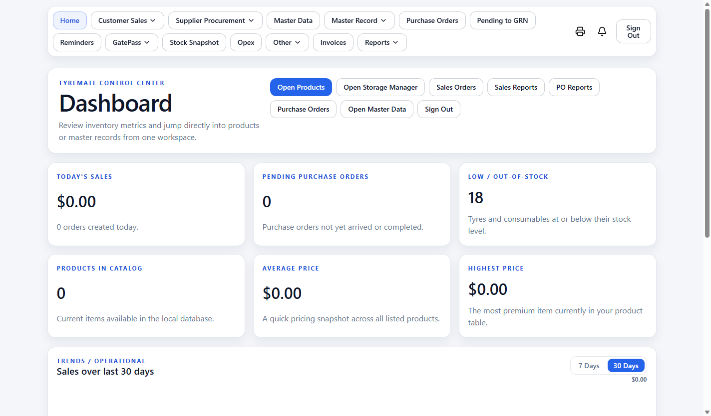

### 2.2 Key Performance Indicators (KPIs)
* **Total Today Sales**: Real-time gross turnover from retail POS, corporate account orders, and retreading services.
* **Pending Orders**: Count of open sales orders requiring picking, tyre mounting, or delivery.
* **DAGs in Progress**: Tyres currently undergoing casing inspection, contractor retreading, or awaiting customer pickup.
* **Low Stock Alerts**: Real-time notifications for tyre sizes and models dipping below safety reorder thresholds.

### 2.3 Navigation Structure
* **Top Navigation Bar**: Displays the active logged-in user, active branch location, system notification bell, and quick logout.
* **Sidebar Menu**: Grouped into logical operational departments:
  * **Sales & Inquiries**: Inquiries, Sales Orders, Direct Invoices, Gate Passes.
  * **Workshop & DAG**: Retreading Intakes, Job Cards, Contractor Gate Passes.
  * **Procurement**: Purchase Orders, Goods Receipt (GRN).
  * **Inventory**: Storage Manager (Racks/Bins), Stock Snapshot, Used Tyres.
  * **Master Data**: Customers, Suppliers, Contractors, Tyres Catalog, Branches.
  * **Reports**: Sales Performance, PO Reports, Cash Flow Statements.

---

## Chapter 3: Customer Inquiry Management

### 3.1 The Inquiry Lifecycle
Customers frequently call or visit requesting tyre availability, price quotations, or retread feasibility before committing to an order. The Inquiry module prevents lost sales by recording customer requirements and converting them into confirmed transactions with a single click.

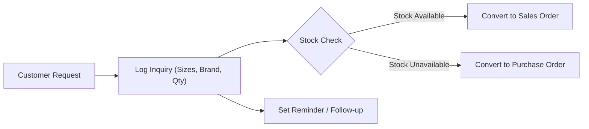

### 3.2 Inquiry Register
Navigate to **Inquiries** via the sidebar.

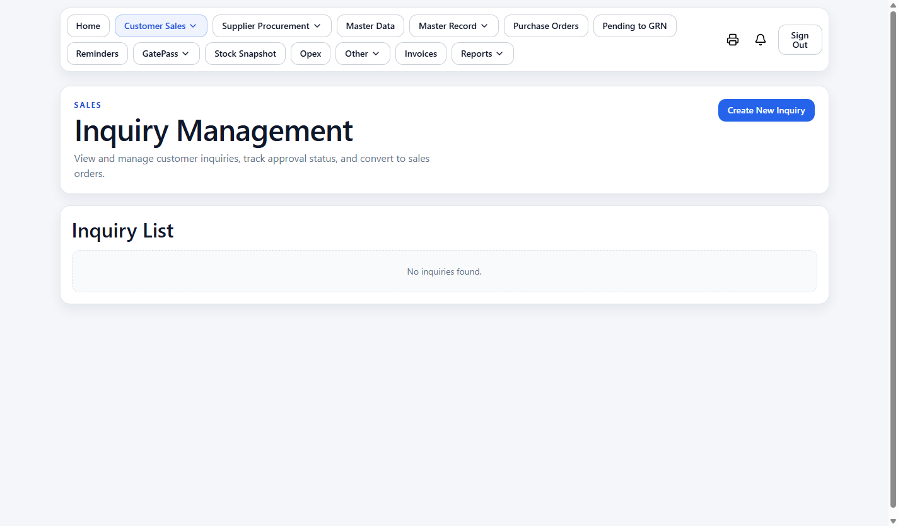

* Filter inquiries by date range, customer name, tyre size, or current status (`Open`, `Follow-up Required`, `Converted`, `Closed`).
* View urgency badges and upcoming follow-up dates.

### 3.3 Logging a New Customer Inquiry
1. Click the **+ New Inquiry** button on the top right.
2. The **Create Inquiry** screen displays:

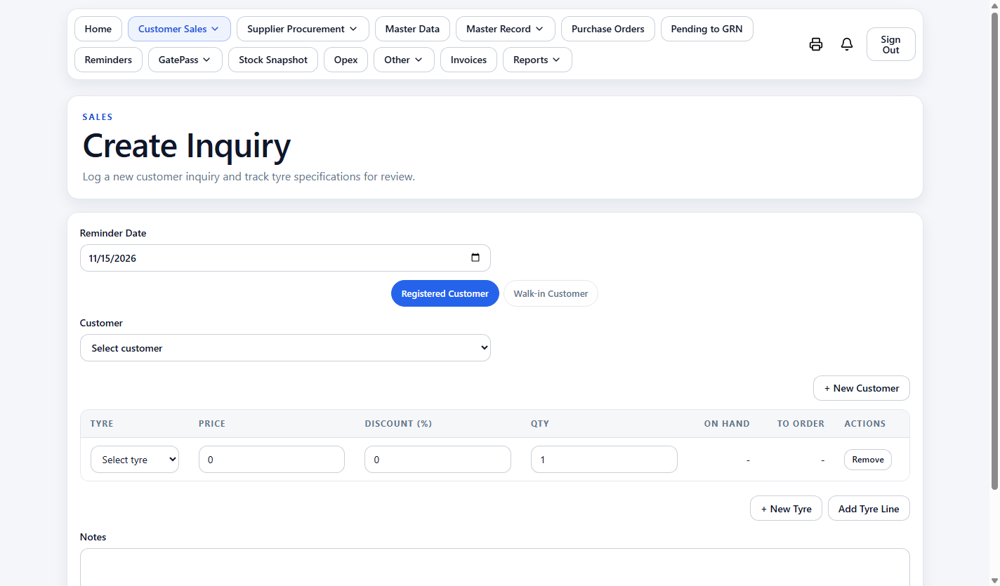

3. **Customer Details**: Select an existing customer or type contact details.
4. **Item Specification**:
   * Select Tyre Size (e.g., `205/55R16`, `11R22.5`).
   * Select Preferred Brand (e.g., `Michelin`, `Bridgestone`, `Dunlop`, `CEAT`).
   * Specify Quantity and Target Price.
5. **Reminder Setup**: Toggle the follow-up reminder date and time to alert front-desk staff.
6. Click **Save Inquiry**.

---

## Chapter 4: Sales Orders & Customer Dispatch

### 4.1 Sales Order Register
The **Sales Orders** page displays all customer transactions across registered corporate accounts and walk-in retail buyers.

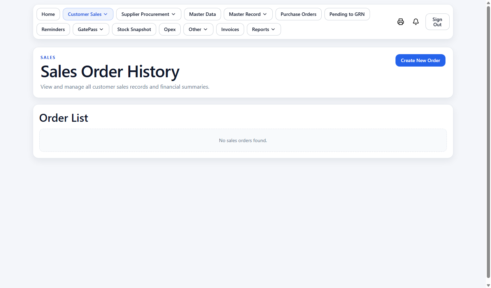

Each record displays:
* **SO Number**: Unique reference identifier.
* **Customer**: Registered business name or walk-in customer profile.
* **Total Amount & Paid Status**: Outstanding balance vs. fully settled.
* **Delivery Status**: Pending, Partially Dispatched, or Fully Delivered.
* **Action Shortcuts**: View details, generate gate pass, or print invoice.

---

### 4.2 Registered Customer Sales Orders
For corporate clients, transport companies, and regular fleet accounts with credit terms:

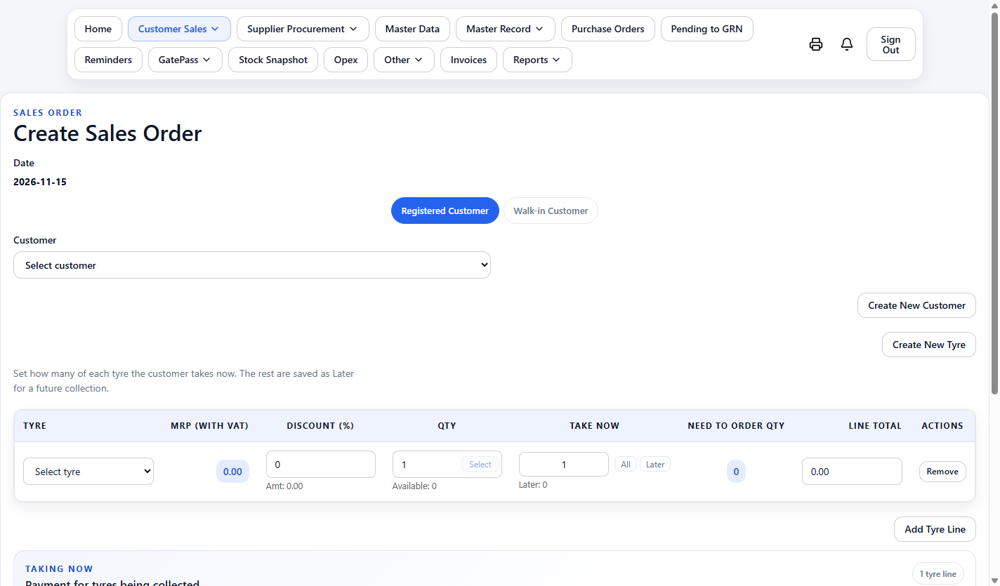

1. Click **+ New Sales Order**. Ensure the **Registered Customer** tab is active.
2. Select the customer from the searchable dropdown.
3. The system immediately loads:
   * **Credit Limit**: Max permitted credit ceiling.
   * **Current Outstanding Balance**: Unsettled invoices.
   * **Applicable Discount Category**: Wholesale or special tier.
4. Add line items:
   * Select Tyre from the catalog.
   * Specify Quantity and Unit Price.
   * Allocate specific storage bin locations for stock reservation.
5. Configure payment terms (Cash, 30 Days Credit, 60 Days Credit, Post-Dated Cheque).
6. Click **Confirm Order**.

---

### 4.3 Walk-in Customer Sales Orders
For retail motorists, cash buyers, and one-off workshop visitors:

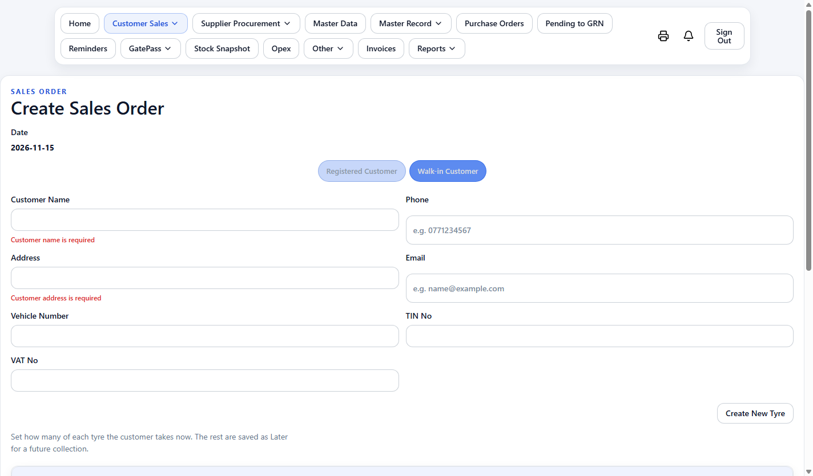

1. On the **Create Sales Order** screen, click the **Walk-in Customer** tab.
2. The registered customer dropdown is replaced with retail intake fields:
   * **Customer Name**: Full name of the motorist.
   * **Contact Number**: Primary mobile phone.
   * **NIC / ID Number**: National Identity Card or Driving License number (optional for low-value cash sales).
   * **Vehicle Number**: Car or lorry registration (e.g., `WP CAB-4521`).
3. Add tyre items and service charges (e.g., Wheel Balancing, Alignment, Valve Replacement).
4. Record immediate payment via Cash, Card, or Instant Bank Transfer.
5. Click **Submit & Generate Invoice**.

---

### 4.4 Gate Pass Generation for Sales Orders
To maintain strict warehouse gate security, no stock can exit the workshop premises without an authorized Gate Pass.

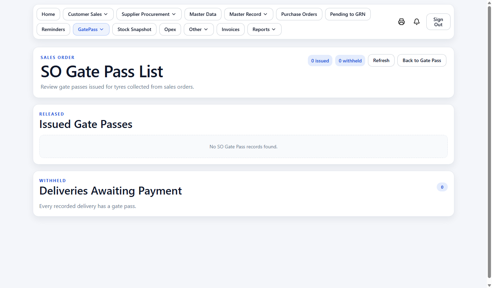

1. Navigate to **Gate Pass $\rightarrow$ SO Gate Pass**.
2. Select the approved Sales Order.
3. Verify tyre serial numbers and quantities loaded onto the vehicle.
4. Enter Driver Name, Vehicle Number, and Security Officer ID.
5. Print the official two-ply Gate Pass slip.

---

## Chapter 5: Direct Action Goods (DAG) / Tyre Retreading

### 5.1 Understanding the DAG Workflow
Direct Action Goods (DAG) is TyreMate's dedicated retreading and casing management engine. Tyres are received from customers, sent to external vulcanizing/retreading contractors, tracked through quality inspection, and returned to customers with clear cost accounting.

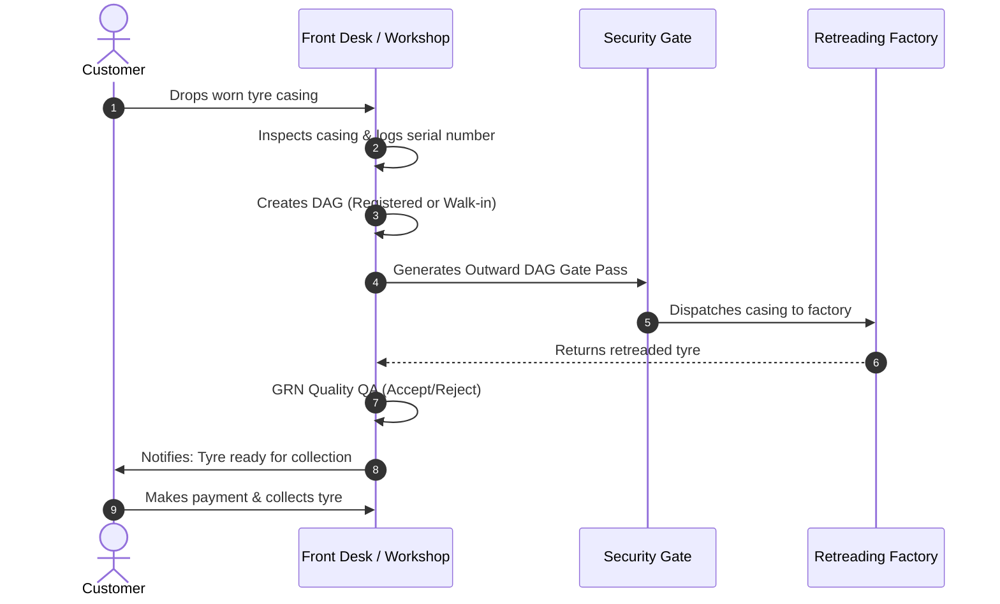

---

### 5.2 DAG Register
Navigate to **DAG** on the sidebar.

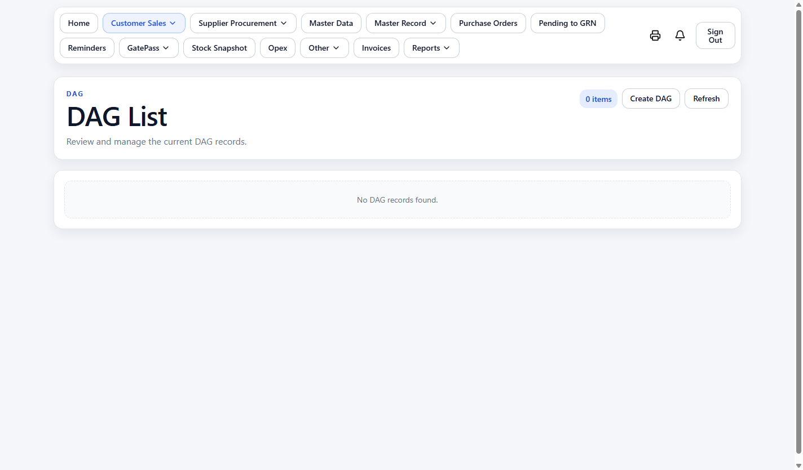

The list tracks every tyre casing by its unique job number, customer name, tyre size, serial number, appointed contractor, and workflow milestone (`Received`, `Sent to Contractor`, `Received at Workshop`, `Delivered to Customer`).

---

### 5.3 Creating a DAG Intake — Registered Customer
For transport fleets sending multiple casings under established contracts:

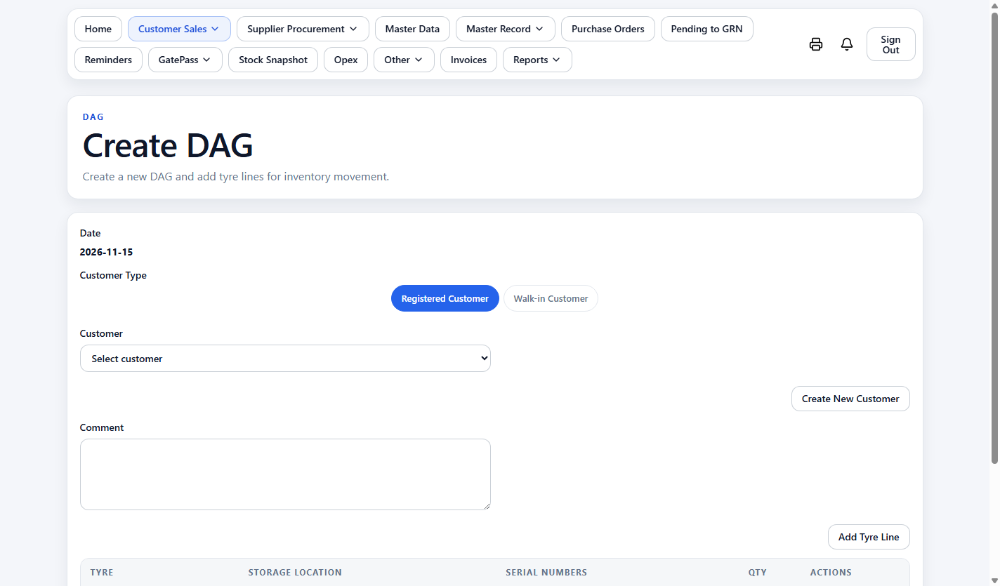

1. Click **+ New DAG Intake**.
2. Select the **Registered Customer** tab.
3. Select the commercial fleet account.
4. Enter the vehicle fleet number or transport unit ID.

---

### 5.4 Creating a DAG Intake — Walk-in Customer
For individual drivers or one-time customers:

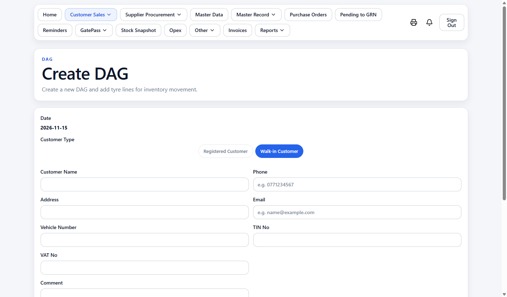

1. On the DAG Intake screen, click the **Walk-in Customer** tab.
2. Enter the customer's **Full Name**, **Contact Number**, and **NIC Number**.
3. Fill in the Casing Specification:
   * **Tyre Brand**: Casing manufacturer (e.g., Michelin, Bridgestone).
   * **Tyre Size**: Cross-section and rim diameter (e.g., `295/80R22.5`).
   * **Serial Number**: Physical stamped serial number on the tyre bead/sidewall.
   * **Requested Tread Pattern**: Selected retread pattern (e.g., Lug, Highway Rib).
   * **Customer Notes**: Special casing condition notes (e.g., minor puncture repair needed).
4. Click **Create DAG Order**. The system issues a numbered customer receipt token.

---

### 5.5 Contractor Gate Pass Issuance
When batching casings for transport to the retreading facility:

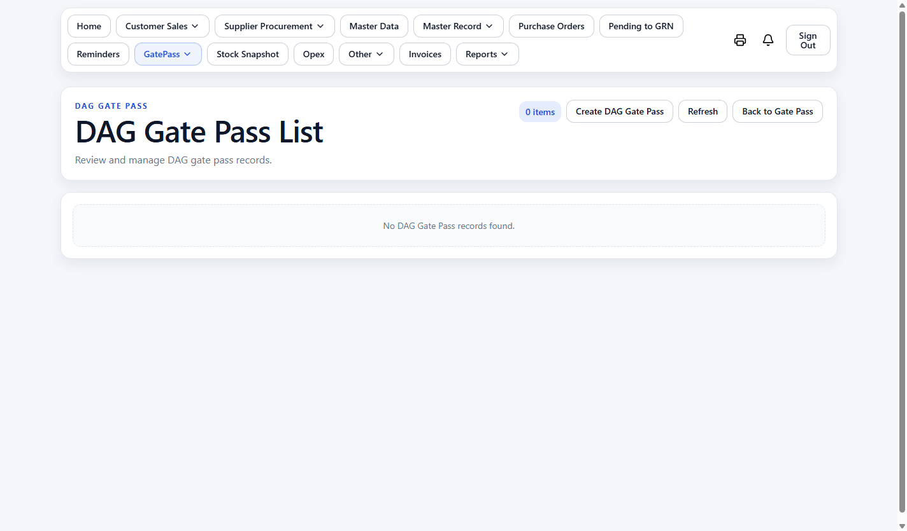

1. Go to **Gate Pass $\rightarrow$ DAG Gate Pass**.
2. Select the assigned **Contractor** (e.g., Colombo Retreaders Ltd).
3. Select the casings ready for transport.
4. Enter the transport carrier details.
5. Click **Issue Gate Pass**. The selected casings advance to status `Sent to Contractor`.

---

## Chapter 6: Procurement & Purchase Orders (PO)

### 6.1 Purchase Order Overview
The PO module manages supplier relations, replenishment orders, and bulk tyre purchasing.

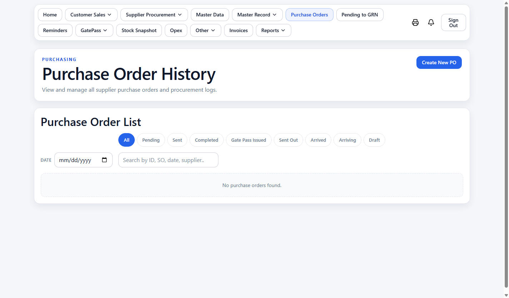

---

### 6.2 Creating a Purchase Order
1. Navigate to **Purchase Orders $\rightarrow$ New Purchase Order**.

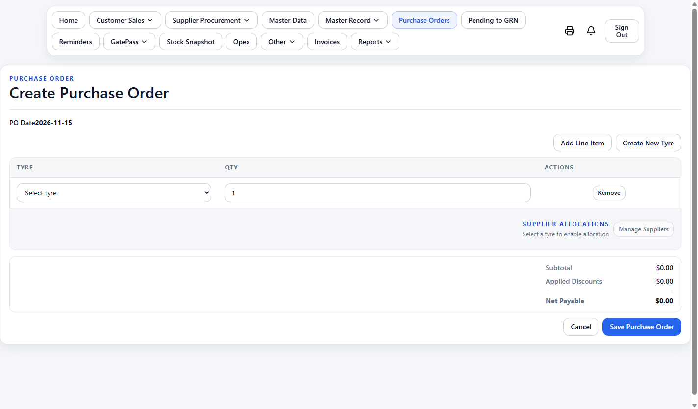

2. **Select Supplier**: Choose a verified manufacturer or wholesale distributor.
3. **Delivery Details**: Set expected arrival date and target warehouse branch.
4. **Line Items**:
   * Add Tyre Models, Sizes, Ply Ratings.
   * Specify unit wholesale purchase price and target order quantities.
5. Review the financial subtotal, import duty/taxes, and terms.
6. Click **Submit Purchase Order**.

---

## Chapter 7: Goods Receipt Notes (GRN) & Quality Control

### 7.1 Pending Inward Receipts
When a supplier delivery truck arrives at the workshop dock, goods must undergo mandatory quality inspection before being added to available stock.

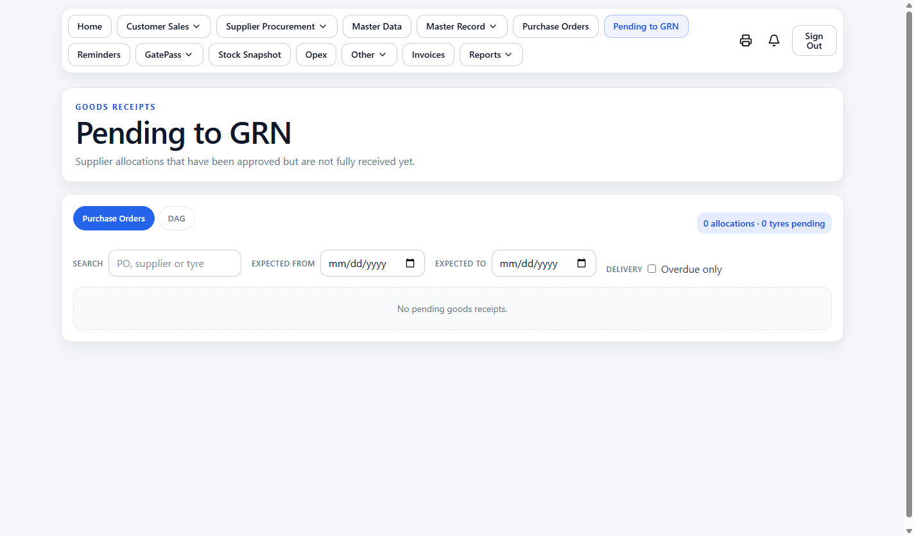

### 7.2 Quality Assurance & Stock Release
1. Open the pending delivery from the **Goods Receipt** queue.
2. Conduct physical inspection:
   * Match physical tyre count against the supplier delivery note.
   * Verify DOT manufacture date codes (ensure tyres are within fresh manufacturing windows).
   * Inspect for bead deformation, compound defects, or transit damage.
3. Record quantities:
   * **Accepted Quantity**: Immediately routed for rack allocation.
   * **Rejected Quantity**: Held in quarantine for supplier credit note / return.
4. Finalize the GRN to update the system inventory automatically.

---

## Chapter 8: Inventory & Multi-Location Storage Management

### 8.1 Storage Location Manager
TyreMate organizes workshop storage into structured Racks, Shelves, and Bins to ensure tyres are located quickly during high-volume operations.

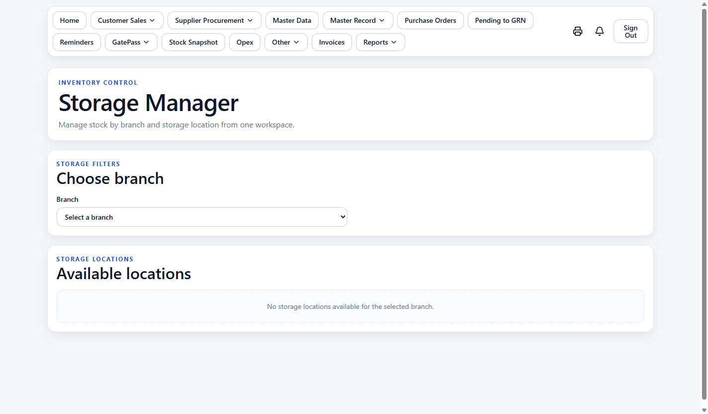

* **Visual Bin Capacity**: Displays current occupancy percentage and max tyre capacity per rack.
* **Zoning**: Segregate New Tyres, Retreads, Customer DAG Holding, and Used Tyres.
* **Bin Allocation**: Assign new GRN items to specific racks with drag-and-drop or dropdown selection.

---

### 8.2 Real-time Stock Snapshot
The **Stock Snapshot** module provides an accurate, live audit of all warehouse holdings.

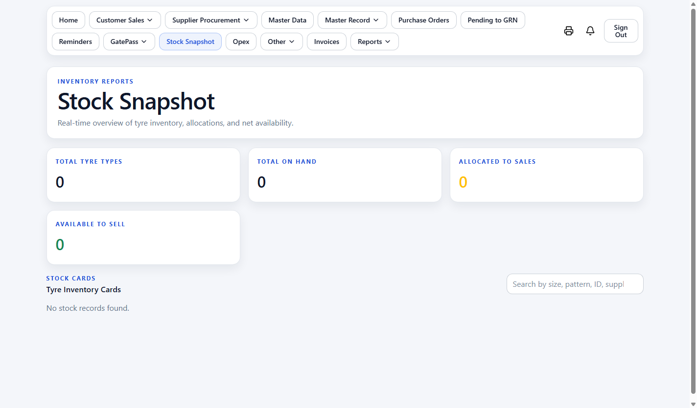

* **Instant Search**: Filter by Brand, Rim Diameter, Width, Profile, Pattern, or Location.
* **Status Badges**:
  * **On Hand**: Physical tyres on premises.
  * **Reserved**: Tyres committed to confirmed Sales Orders awaiting pickup.
  * **Available**: Net stock unreserved and ready for sale.
  * **Reorder Alert**: Highlighted when net stock falls below defined thresholds.

---

## Chapter 9: Master Data Administration

### 9.1 Master Data Hub
The **Master Data Hub** manages system-wide entities, ensuring standard pricing, customer profiles, and product catalogs.

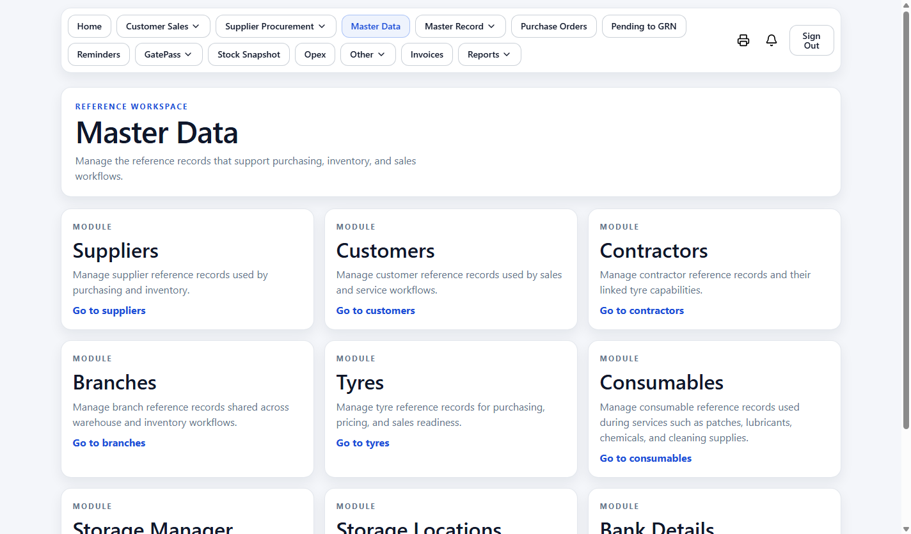

---

### 9.2 Customer Directory
Maintain corporate accounts, credit terms, and contact directories.

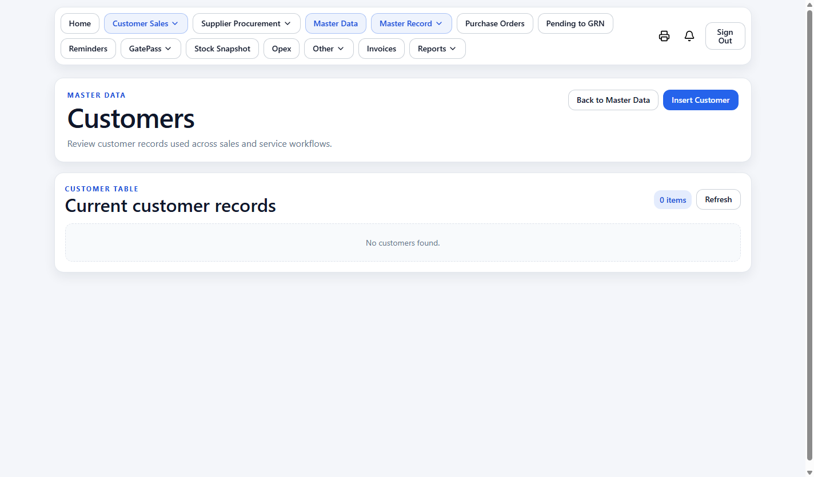

* Configure credit days (e.g., 14, 30, 60 days).
* Set maximum credit limits.
* Record VAT/TIN numbers for tax reporting.

---

### 9.3 Tyre Master Catalog
Centralize specifications and pricing for all tyre products handled by the business.

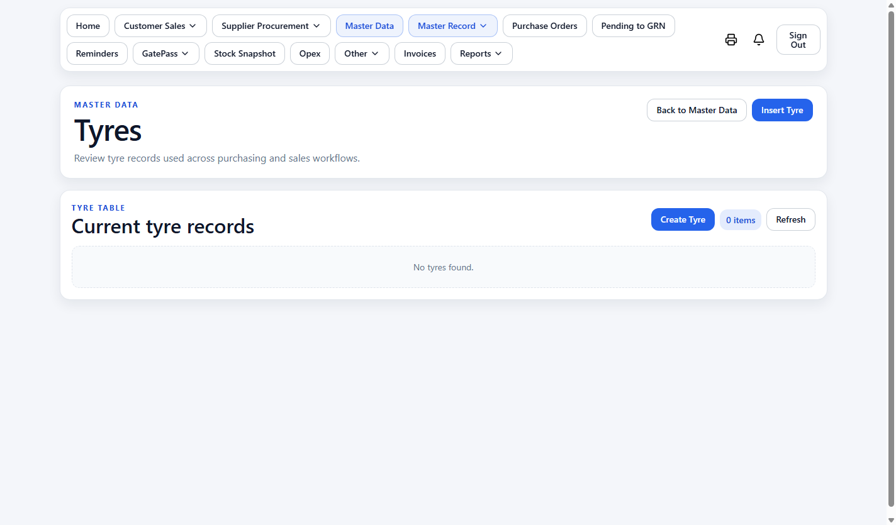

* **Technical Specs**: Section Width, Aspect Ratio, Construction Type, Rim Diameter, Load Index, Speed Rating.
* **Financial Data**: Standard Wholesale Cost, Minimum Selling Price, Retail MSRP.
* **Inventory Control**: Reorder point and minimum stock safety buffer.

---

## Chapter 10: Invoices, Billing & Payment Receipts

### 10.1 Commercial Invoice Register
View, manage, and print tax invoices issued across all sales and retreading operations.

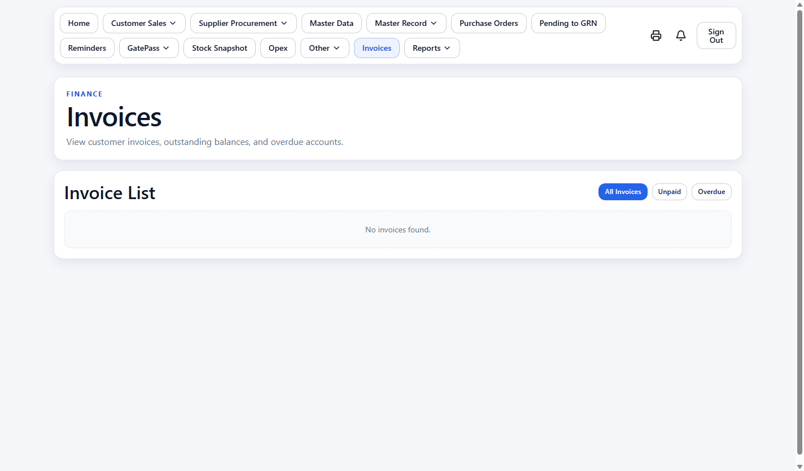

* **Direct Invoicing**: Create standalone counter invoices for rapid retail parts/services.
* **Sales Order Billing**: Automatically generates finalized commercial invoices when goods are dispatched.
* **Payment Tracking**: View settlement status (`Paid`, `Partial`, `Overdue`).

### 10.2 Payment Receipting
TyreMate supports versatile multi-tender settlement:
* **Cash**: Instant register balance update.
* **Credit/Debit Card**: Terminal reference number capture.
* **Cheque Management**: Record Cheque Number, Bank, Branch, and Due Date with an alert register for clearing.
* **Direct Bank Transfer**: Capture reference slips and bank reconciliation notes.

---

## Chapter 11: Reports & Financial Analytics

### 11.1 Sales Analytics & Profit Margins
Analyze sales trends, top-moving tyre sizes, and gross profit margins across customizable date ranges.

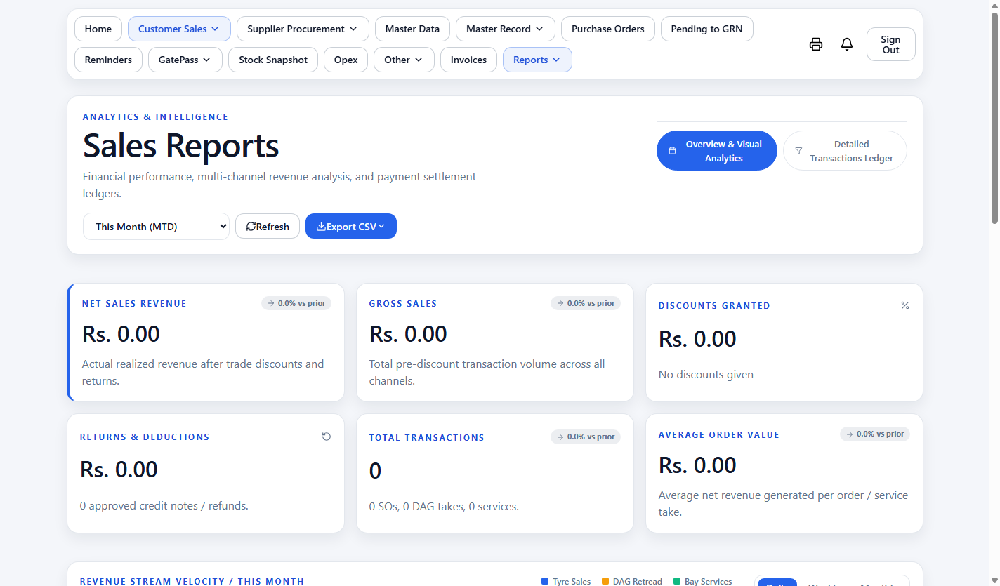

* **Revenue Breakdown**: Filter by Brand, Size, Product Group, or Salesperson.
* **Profitability Analysis**: Compare standard purchase cost against realized selling price to identify high-margin sizes.
* **Export Options**: Export directly to formatted Excel, CSV, or PDF summary sheets.

---

### 11.2 Cash Flow & Liquidity Reports
Monitor workshop cash inflows and outflows to maintain healthy working capital.

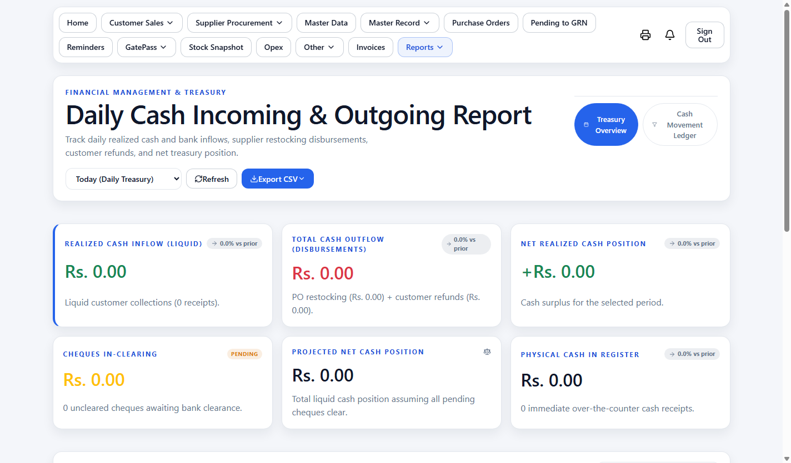

* **Operational Cash Flow**: Real-time inflows from cash sales, customer collections, and retreading job payments.
* **Outflows**: Supplier settlements, contractor retreading fees, operational workshop expenses (OPEX).
* **Outstanding Receivables**: Ageing summary (30 / 60 / 90+ days) for corporate fleet credit accounts.

---

## Chapter 12: Troubleshooting, Security & Industrial Practices

### 12.1 Local Database Security & Protection
In commercial workshop environments, database files stored in local user directories (`AppData`) must be protected from accidental deletion or unauthorized tampering:
* **Database File**: Located at `%APPDATA%\tyremate\tyremate.db`.
* **Industrial Encryption**: In production deployments, SQLCipher 256-bit AES encryption locks the database, preventing unauthorized users from inspecting or modifying tables with generic SQLite viewers.
* **Scheduled Backups**: TyreMate creates automatic rotating daily snapshots to a secured secondary drive or cloud backup target.

### 12.2 Daily Operational Checklist
1. **Morning Opening**:
   * Review Dashboard KPI cards for pending deliveries and critical stock alerts.
   * Check Cheque Clearing Register for post-dated cheques maturing today.
2. **During Operations**:
   * Ensure every tyre dispatched has a corresponding authorized Gate Pass.
   * Record every casing serial number at intake to prevent customer disputes.
3. **Evening Closing**:
   * Run Cash Register reconciliation against physical cash and card terminals.
   * Finalize all pending Goods Receipt Notes to reflect accurate closing stock.

### 12.3 Keyboard Shortcuts & Quick Actions
| Shortcut | Action |
| :--- | :--- |
| <kbd>Ctrl</kbd> + <kbd>N</kbd> | Open New Sales Order |
| <kbd>Ctrl</kbd> + <kbd>D</kbd> | Open New DAG Intake |
| <kbd>Ctrl</kbd> + <kbd>F</kbd> | Focus Global Search Bar |
| <kbd>Ctrl</kbd> + <kbd>P</kbd> | Print active Invoice / Gate Pass / Report |
| <kbd>Esc</kbd> | Close active modal dialog |

---
*TyreMate ERP &copy; Dev Ceylone. All rights reserved.*
